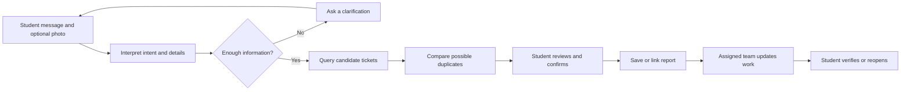

# FixMyBlock

### From an informal complaint to a verified repair.

FixMyBlock is an AI-assisted campus maintenance prototype. Students describe problems in their own words, maintenance teams receive clear reports, and students confirm whether the repair worked.

**Built around NITK Surathkal for demonstration. This is an independent student project, not an official NITK service. All starter incidents are fictional.**

## The problem

A useful maintenance report needs more than a message saying “there is water outside my hostel.” Staff need to know what is wrong, where it is, and whether someone has already reported the same fault. Students also need a way to see progress and confirm the outcome.

FixMyBlock connects these steps in one workflow.

## The solution

| User | What they can do |
| --- | --- |
| Student | Describe a problem, add an optional photo or map pin, review the report, track progress, and confirm or reopen a repair. |
| Maintenance team | See its assigned work, record updates, and request repair verification. |
| Administrator | Monitor team workloads and create, reset, or disable maintenance accounts. |

Reports cover **lighting, waste, roads, and drainage**, including leaking taps and pipes. Each category maps to the corresponding maintenance team.

## Why AI belongs here

The database stores and retrieves tickets. AI helps interpret the unstructured evidence that arrives before a useful ticket exists.

| Task | Approach |
| --- | --- |
| Understand informal wording, misspellings, and mixed-language complaints | Gemini extracts the issue and relevant details. |
| Clarify an ambiguous problem | Gemini asks for missing information; backend guards also handle selected ambiguous cases. |
| Interpret an optional photo | Gemini describes visible evidence and uncertainty. |
| Find possible duplicate tickets | Database queries filter by category and location; Gemini compares whether candidates describe the same physical issue. |
| Save tickets, enforce access, and change status | Validated backend operations and database records. |

For example, a broken rear-gate lamp and a broken bathroom lamp can share the same hostel and category while requiring different repairs. Matching those fields alone is not enough to establish a duplicate.

**Students confirm both new submissions and proposed duplicate links.** AI cannot independently mark repairs complete or grant staff access.

## The agentic workflow

LangGraph coordinates a bounded workflow around Gemini interpretation and database operations. Conversation state is saved between requests.

Unrelated requests do not proceed to submission. Corrections update the draft, and conflicting named landmarks and map pins require review. Changing photo or pin evidence also requires another review before submission.

The project uses **task-specific prompting, structured outputs, and workflow validation**. It does not use a fine-tuned or retrained Gemini model.

## What judges can evaluate

1. **Student experience:** an unclear observation becomes a reviewed report through clarification and correction.
2. **AI contribution:** informal and mixed-language input is interpreted, and candidate duplicates are compared by meaning.
3. **Operational workflow:** the report appears in the assigned team's queue and progresses through repair verification.
4. **Human control:** the student confirms submission and the outcome; administrators manage staff access.

The complete lifecycle is **Assigned → In progress → Awaiting verification → Resolved**. A student can reopen an unresolved repair.

## Implementation

| Layer | Technology |
| --- | --- |
| Interface | Next.js, React, TypeScript |
| API and validation | Python, FastAPI |
| AI interpretation | Gemini API |
| Workflow orchestration | LangGraph |
| Persistence | SQLite |
| Student authentication | WorkOS six-digit email codes for `@nitk.edu.in` addresses |
| Staff authentication | Admin-created accounts with team-scoped permissions |
| Campus map | Leaflet and OpenStreetMap, with Google Maps links |

## Validation

The latest verification completed **69 automated tests** and a successful production build. Tests cover permissions, report lifecycle, duplicate confirmation, corrections, cancellation, evidence changes, map conflicts, and provider failures.

Additional live Gemini checks exercised ambiguous wording, partial cancellation, location corrections, mixed Hindi-English input, and same-asset versus different-asset comparisons. A map-conflict failure discovered during testing was fixed with a backend distance check and retested through pin correction.

Automated tests use isolated databases and mock external services. **The test count is a software-reliability result, not an AI accuracy score.** No measured improvement in campus repair times is claimed.

See [the test suite](tests/) and [local setup instructions](docs/SETUP.md) to inspect or reproduce the implementation.

## Prototype boundaries

- No official NITK, municipal, or real maintenance-dispatch integration is connected.
- Gemini requires network access and available quota; configured-provider failures are shown explicitly rather than silently replaced with rule-based answers.
- A separately labelled, limited keyword demo is available without a Gemini key.
- Complaint text, relevant candidate records, and optional photos are sent to Gemini when configured. Uploaded photos should exclude faces and personal information.
- Campus landmarks are approximate. Email verification establishes inbox ownership, not enrollment status.
- The prototype runs on a single host with SQLite. It is not an emergency service or a managed production deployment.
